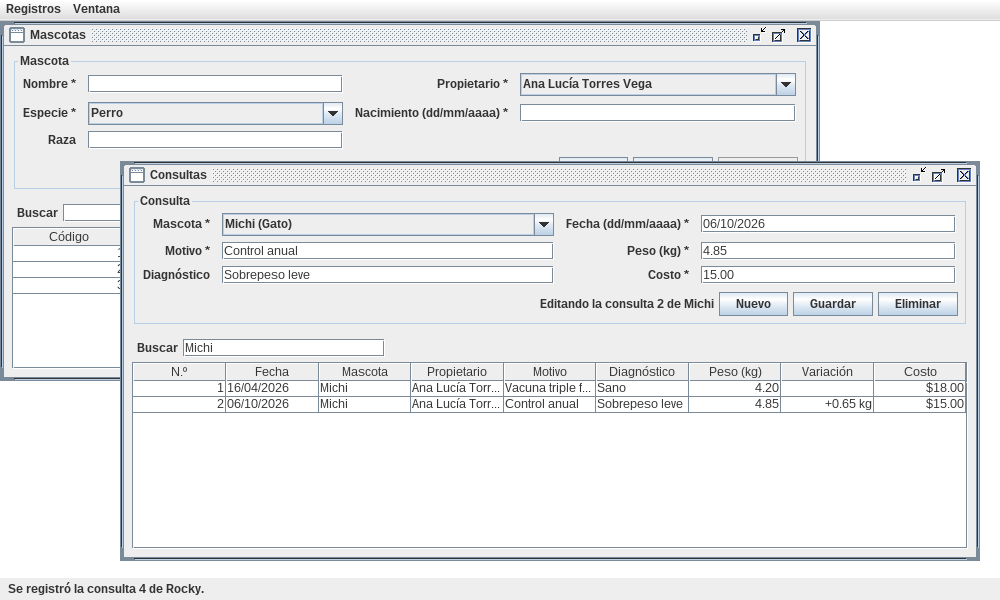

# java-mdi-veterinaria

[](https://github.com/Whiteherobot/java-mdi-veterinaria/actions/workflows/ci.yml)

Clínica veterinaria de escritorio en Java Swing con interfaz MDI: una ventana
principal con menú y un escritorio donde cada módulo se abre como ventana
interna. Ejercicio 03.05 de Programación Orientada a Objetos (junio de 2022),
cuyos temas eran las ventanas internas con menú, los avisos al usuario y las
relaciones entre entidades.



- **Propietarios y mascotas**: cada mascota pertenece a un propietario. La
  mascota guarda especie, raza y fecha de nacimiento, con la edad calculada en
  años y meses.
- **Consultas**: fecha, motivo, diagnóstico, peso y costo. Al buscar el nombre
  de una mascota se ve su historial, con la variación de peso respecto de la
  consulta anterior.
- **Reglas**: una consulta no puede tener fecha futura ni ser anterior al
  nacimiento de la mascota. No se elimina un propietario con mascotas ni una
  mascota con consultas.
- **MDI**: el menú *Registros* abre Propietarios, Mascotas y Consultas. Cada
  módulo se abre una sola vez y, si ya está abierto, pasa al frente. El menú
  *Ventana* las ordena en cascada o las cierra todas. Al activar una ventana
  se recargan sus datos, por si otra los cambió.
- **Avisos**: los registros y las eliminaciones se confirman en la barra de
  estado. Los errores y las confirmaciones aparecen en diálogos.

## Cómo correrlo

Necesitas JDK 17 o superior. El proyecto trae el wrapper de Maven.

```bash
./mvnw verify                             # compila y corre las pruebas
java -jar target/mdi-veterinaria-1.0.0.jar
```

Arranca con dos propietarios, tres mascotas y algunas consultas de ejemplo.

## Estructura

```
src/main/java/veterinaria/
├── modelo/       Propietario, Mascota, Especie y Consulta
├── servicio/     Repositorio genérico y Clinica (relaciones, fechas e historial)
├── controlador/  Un controlador por módulo
└── vista/        VentanaClinica (MDI) y un panel por módulo sobre un PanelCrud común
```

Las pruebas cubren la edad, las reglas de fechas e integridad, el historial y
los paneles, y corren en GitHub Actions con Java 17 y 21.

## De dónde sale

La entrega de 2022 repetía el sistema de clientes, productos y facturas de los
ejercicios anteriores (ver
[java-facturacion-jtable](https://github.com/Whiteherobot/java-facturacion-jtable)
y [java-crud-facturas](https://github.com/Whiteherobot/java-crud-facturas)),
ahora dentro de un `JDesktopPane`, con los mismos errores de búsqueda y
modificación. En 2026 se mantuvieron los temas del ejercicio (MDI, avisos y
relaciones) aplicados a un dominio nuevo.

## Autor

Michael Lata ([@Whiteherobot](https://github.com/Whiteherobot)). Licencia MIT.
